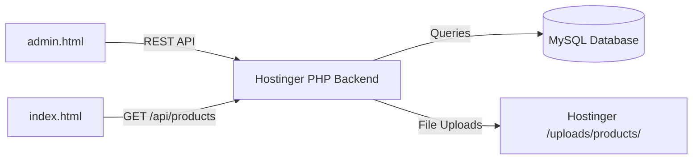

# ZEROØ FRAGRANCE — Demo Admin Panel Documentation

## Overview
This documentation describes the lightweight, vanilla frontend **Demo Admin Panel** created for **ZERØ FRAGRANCE**. It provides a presentation-ready catalog and inventory management interface designed with a dark luxury perfume brand aesthetic (black, cream, and gold).

---

## 1. File Structure
The following dedicated files were created without modifying or breaking any existing storefront files (`index.html`, `css/style.css`, `js/app.js`, `js/products.js`):

- **[admin.html](file:///c:/Z%20FRAG/admin.html)**: The Admin Panel interface (Login view, Dashboard metrics, Catalog table, Add/Edit modal, Confirmation modal).
- **[css/admin.css](file:///c:/Z%20FRAG/css/admin.css)**: Dedicated stylesheet using the signature black, cream, and gold perfume aesthetic, fully responsive across mobile, tablet, and desktop.
- **[js/admin-storage.js](file:///c:/Z%20FRAG/js/admin-storage.js)**: Data access layer managing `localStorage` for product metadata and `IndexedDB` for local image storage (preventing localStorage quota exhaustion).
- **[js/admin.js](file:///c:/Z%20FRAG/js/admin.js)**: Admin interaction controller for authentication state, live metric updates, CRUD operations, search/filters/sorting, and toast notifications.
- **[README-ADMIN.md](file:///c:/Z%20FRAG/README-ADMIN.md)**: This documentation and future Hostinger PHP/MySQL migration roadmap.

---

## 2. How to Access the Admin Panel Locally
1. Ensure your local server is running (e.g. `http://localhost:8080`).
2. Open your browser and navigate to:
   👉 **`http://localhost:8080/admin.html`**
3. **Demo Login**:
   - Username: `admin` (or any name)
   - Password: `demo123` (or any password)
   - Click **Access Admin Panel ↗**.

---

## 3. Implemented Demo Features

### A. Dashboard Metrics
- **Total Products**: Live counter of all fragrance items in catalog.
- **In-Stock Products**: Count of fragrances with inventory > 5.
- **Out-of-Stock Products**: Count of fragrances with 0 stock.
- **Total Stock Units**: Sum total of all available fragrance bottles.
- **Recently Added & Low-Stock Alerts**: Cards showing recent fragrances and items needing restock (1–5 bottles).

### B. Product Management (CRUD)
- **Add Product**: Modal form supporting Name, Unique ID, BDT Price (৳), Stock quantity, Category, Visibility Status (Active/Inactive), Catchphrase/Description, Fragrance Notes, and Image Upload.
- **Edit Product**: Update prices, quantities, notes, status, or replace images.
- **Delete Product**: Custom luxury confirmation dialog before deleting an item.
- **Search & Filter**: Real-time search across names, IDs, notes, category filter, stock level filter, and sorting (price, stock, name, date).
- **Stock Threshold Badges**:
  - `Quantity = 0` → **OUT OF STOCK** (Red badge)
  - `Quantity 1–5` → **LOW STOCK** (Amber badge)
  - `Quantity > 5` → **IN STOCK** (Emerald badge)
- **Storefront Visibility**: Inactive items can be marked as hidden.

### C. Image Upload with IndexedDB
- Allows selecting local image files from the computer (JPG, PNG, WebP).
- Instant preview box before saving.
- Stored as binary Blobs in browser `IndexedDB` (`ZeroFragranceDemoDB`), avoiding large Base64 strings in `localStorage`.

---

## 4. Demo-Only Limitations
- **Browser-Only Storage**: All changes (products, stock levels, uploaded photos) are persisted inside the local browser (`localStorage` + `IndexedDB`). They are **not** shared across other computers or browsers.
- **Demo Authentication**: The login screen is a presentation mockup stored in `sessionStorage`. It does not perform server-side credential verification or cryptographically secure token validation.
- **Storefront & Admin Integration**: The public storefront (`index.html`) and the Admin Panel (`admin.html`) now share one unified store via `js/products.js` (`window.ZeroStore`). Product additions, updates, stock status, and uploaded images sync instantly across pages and browser tabs via `BroadcastChannel` and `storage` events.

---

## 5. Hostinger PHP/MySQL Integration Roadmap (Future Production)
To connect this Admin Panel and Storefront to a centralized database so that every customer and admin sees the same real-time products:



### Steps to Implement on Hostinger:
1. **Create MySQL Database**:
   ```sql
   CREATE TABLE products (
       id VARCHAR(50) PRIMARY KEY,
       name VARCHAR(150) NOT NULL,
       price DECIMAL(10,2) NOT NULL,
       stock INT NOT NULL DEFAULT 0,
       category VARCHAR(100),
       status ENUM('active', 'inactive') DEFAULT 'active',
       description TEXT,
       notes TEXT,
       image_url VARCHAR(255),
       created_at TIMESTAMP DEFAULT CURRENT_TIMESTAMP,
       updated_at TIMESTAMP DEFAULT CURRENT_TIMESTAMP ON UPDATE CURRENT_TIMESTAMP
   );

   CREATE TABLE admins (
       id INT AUTO_INCREMENT PRIMARY KEY,
       username VARCHAR(50) UNIQUE NOT NULL,
       password_hash VARCHAR(255) NOT NULL,
       created_at TIMESTAMP DEFAULT CURRENT_TIMESTAMP
   );
   ```

2. **Create REST API Endpoints (`api/products.php`)**:
   - `GET /api/products.php` (Public: returns active products for storefront and admin).
   - `POST /api/products.php` (Protected: creates a new fragrance).
   - `PUT /api/products.php?id={id}` (Protected: updates stock, price, or details).
   - `DELETE /api/products.php?id={id}` (Protected: removes a fragrance).
   - `POST /api/upload.php` (Protected: receives `multipart/form-data`, saves files to `/uploads/products/` and returns URL).

3. **Secure Server Authentication (`api/auth.php`)**:
   - Implement `password_hash()` and `password_verify()` with bcrypt/Argon2.
   - Issue HTTP-only secure session cookies or JWT tokens to authenticate admin requests.

4. **Connect Frontend**:
   - The codebase now implements `ZeroStoreRepository` in `js/products.js`.
   - When deploying to Hostinger, create an `ApiProductAdapter` implementing the exact same contract (`getProducts`, `saveProducts`, `saveImage`, `getImage`, `deleteImage`, `subscribe`) by executing HTTP `fetch()` requests against `api/products.php`.
   - Zero modifications are needed in `admin.js` or `app.js` UI logic.
